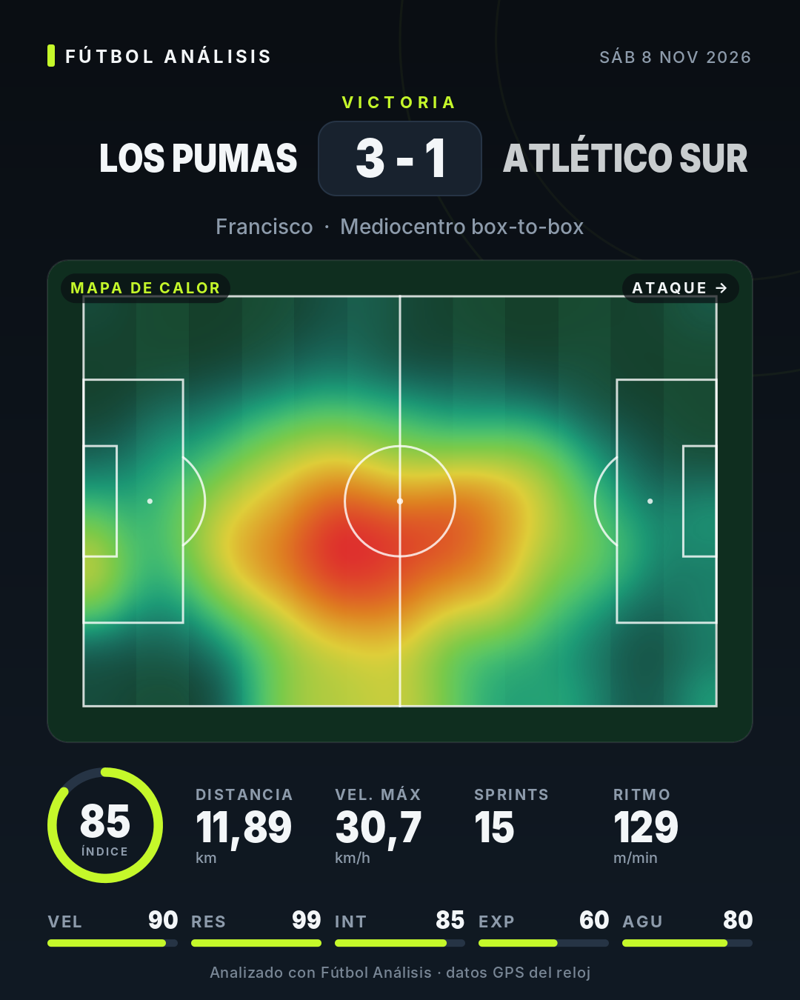

# Fútbol Análisis (v0.4)

App Android para analizar partidos de fútbol con datos de un reloj (empezando por Amazfit Bip Max vía Zepp):
rendimiento físico, frecuencia cardiaca, análisis táctico y mapa de calor.



## Cómo se usa

1. En Zepp, exporta el entrenamiento del partido como **GPX** (o descárgalo de Strava como GPX/TCX).
2. En la app: **Agregar partido** (o compártelo desde Zepp/Strava/Archivos directo a la app) y completa equipo, rival y fecha.
3. Opcional: en **Health Connect** (icono ♥) concede permisos. La app completa la FC si el GPX no la trae
   y muestra HRV, SpO2, VO2 máx, FC en reposo y pasos. Si Zepp escribe la ruta GPS en Health Connect,
   puedes analizar la sesión directamente desde ahí.
4. ¿Sin datos aún? **Probar con un partido de ejemplo** carga un partido sintético de un mediocampista.

## Qué calcula

| Pestaña | Métricas |
|---|---|
| Físico | distancia, m/min, velocidad máx, distancia por 5 zonas de velocidad, sprints, carreras de alta intensidad, aceleraciones/frenadas, bloques de 15', metros por minuto, índice de fatiga |
| Mapa de calor | mapa de calor del partido y por tiempo, posición media |
| Táctico | posición estimada, ocupación 3×3 (tercios × carriles), área de influencia, presencia en áreas, mapa de sprints con dirección |
| Fisiología | FC media/máx, tiempo en zonas Z1–Z5, TRIMP de Edwards, tiempo >85% FCmáx, curva de FC, estado del día (HRV vs. media 7 días, SpO2, VO2 máx, pasos) |

## Novedades de la v0.4

Inicio con rendimiento general y último partido, índice de rendimiento con cinco atributos, comparación entre partidos
(contra tu promedio o cara a cara), mapa de calor sobre vista satelital e imagen para Instagram. Ver [DECISIONES.md](DECISIONES.md).

## Estructura

```
core/   Motor de análisis en Kotlin puro (sin Android). Parsers GPX/TCX, calibración de cancha,
        análisis físico, FC, táctico y mapa de calor. 23 pruebas.
app/    App Android (Jetpack Compose + Material 3 + Health Connect).
```

## Compilar

- **Android Studio** (Ladybug o más nuevo): abrir la carpeta y ejecutar `app`.
- **Terminal**: `./gradlew :app:assembleDebug` → `app/build/outputs/apk/debug/app-debug.apk`.
- **GitHub Actions**: cada push ejecuta las pruebas y sube el APK como artefacto (`.github/workflows/android.yml`).
- Solo el motor: `./gradlew :core:test` y `./gradlew :core:demo` (genera un partido de ejemplo, el reporte JSON y un PNG del mapa de calor en `core/build/demo/`).

El módulo `app` solo se incluye si hay SDK de Android (`local.properties` o `ANDROID_HOME`).

Ver [DECISIONES.md](DECISIONES.md) para las decisiones de diseño y la hoja de ruta.
